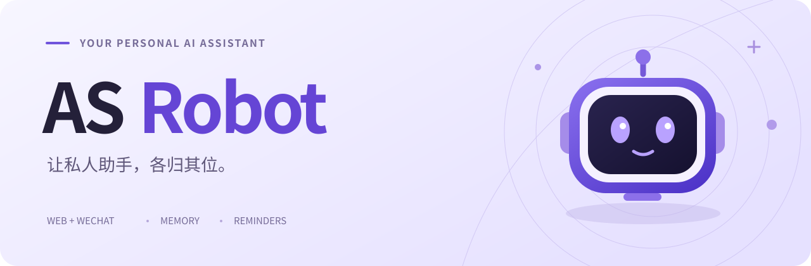
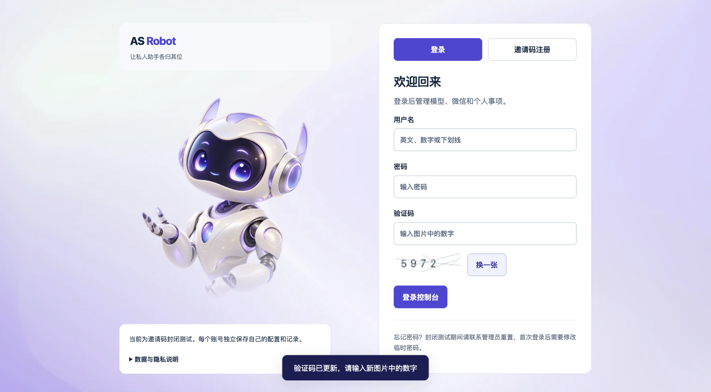
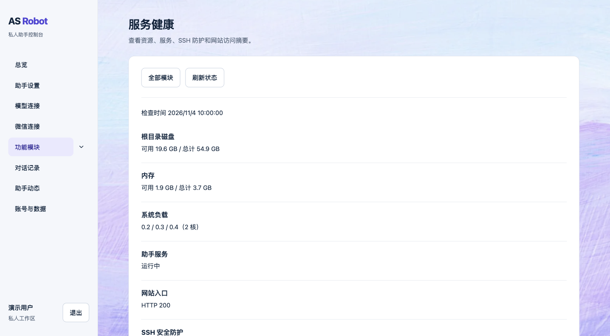

<a id="top"></a>

<div align="center">
  
  <h1>把日常，交给懂你的助手。</h1>
  <p><strong>网页里配置，微信里相伴。</strong><br />记住偏好、安排提醒、整理信息，让每个人都有自己的私人 AI 助手。</p>
  <p>
    <a href="https://asrobot.par73e.cn/asrobot/"></a>
    <a href="#开始使用"></a>
  </p>
  <p>
    
    
    <a href="LICENSE"></a>
  </p>
  <p><a href="#产品预览">产品预览</a> · <a href="#核心能力">核心能力</a> · <a href="#日常体验">日常体验</a> · <a href="#开发者入口">开发者入口</a> · <a href="https://github.com/par73e/MyBot/issues">反馈问题</a></p>
  <sub>AS Robot 为产品名，MyBot 为源码仓库名。当前采用邀请码封闭测试。</sub>
</div>

<br />

## 产品预览

用一个工作区管理自己的助手，在熟悉的微信里继续对话。

<table>
  <tr>
    <td width="50%"></td>
    <td width="50%"></td>
  </tr>
  <tr>
    <td align="center"><strong>从这里遇见你的 Robot</strong><br /><sub>登录、邀请码注册，进入自己的工作区</sub></td>
    <td align="center"><strong>配置与状态，清楚可见</strong><br /><sub>响应式控制台，集中管理功能与助手动态</sub></td>
  </tr>
</table>

<sub>健康页使用演示账号与示例数据，仅展示界面，不代表当前生产状态。点击图片可查看大图。</sub>

## 核心能力

<table>
  <tr>
    <td width="50%" valign="top"><h3>🗓️ 让事情按时发生</h3><p>待办、固定与重复提醒、截止日期跟进、物品与服务到期管理。完成、取消或延期后，同步后续安排。</p></td>
    <td width="50%" valign="top"><h3>🧠 少重复，多理解</h3><p>保存长期偏好和有期限的短期安排；支持查看、纠正与归档。过去的对话按日期回查，过期记忆不会一直生效。</p></td>
  </tr>
  <tr>
    <td valign="top"><h3>☀️ 从早安到晚安</h3><p>晨报汇集天气、课程、邮件、待办与 AI 新闻；晚间总结帮助收尾。主动联系遵循你的作息与日期例外。</p></td>
    <td valign="top"><h3>📬 先看到值得关注的</h3><p>QQ / Gmail 邮件增量筛选、重要通知与静默汇总。外部邮件提出的待办建议，确认后才加入安排。</p></td>
  </tr>
  <tr>
    <td valign="top"><h3>🌦️ 为日程多想一步</h3><p>周课表、教学周、课前提醒与校历调休；结合明确行程和已设规律查询天气、关注官方预警。</p></td>
    <td valign="top"><h3>🔎 跟进关心的变化</h3><p>阅读 AI 新闻简报，跟踪公开 GitHub PR 的评论、审核、合并与 CI 变化；在工作区查看助手活动。</p></td>
  </tr>
</table>

## 日常体验

### 说出需求，再看见结果

| 你可以这样说 | 交给 Robot 的事情 |
| :--- | :--- |
| “下周三下午三点提醒我交报告。” | 创建固定提醒，在网页里查看和调整 |
| “这周回答简短一点，下周恢复原来的风格。” | 保存有期限的偏好，到期恢复长期设置 |
| “帮我看看最近有哪些重要邮件。” | 读取已连接邮箱，整理值得关注的信息 |
| “跟进这个公开 PR，有审核意见时告诉我。” | 持续关注已配置的 PR 变化 |

<sub>以上是使用场景示例，实际执行取决于模型理解、已连接服务及必要确认；只有工具执行成功后才算完成设置。</sub>

### 每个人，都有自己的 Robot

- **名称与风格由你决定。** 自定义助手名称、称呼、模型和回复偏好；每个账号使用独立的助手实例、配置与数据。Friday 是所有者的个人实例名。
- **你来决定何时被打扰。** 前台对话全天可用，自动事件遵循作息；窗口外提醒跳过，不挪到起床补发。固定提醒到点发送预先准备的文字。
- **睡前的“明天”，更贴近日常习惯。** 凌晨 00:00–05:59 默认延续前一会话日理解相对日词，明确日期、星期和起床语境优先。规则已上线，真实凌晨对话效果仍待实际使用验证。
- **重要信息有出处。** 天气、预警、新闻和 PR 保留来源与时间；按行程推断的地点不冒充实时 GPS，教学日也不等于当天一定有课。

## 开始使用

| 步骤 | 做什么 |
| :---: | :--- |
| **01** | **[打开 AS Robot](https://asrobot.par73e.cn/asrobot/)**，使用已有账号登录，或凭邀请码注册 |
| **02** | **设置你的助手**，填写名称、回复偏好与模型连接 |
| **03** | **连接微信**，完成配对后发送第一条消息 |
| **04** | **按需连接服务**，配置邮箱、天气、GitHub、课程与作息 |

> **当前为邀请码封闭测试。** 部分服务需要自行提供模型密钥或完成第三方授权，并可能产生费用。新账号开通与真实微信配对仍在完善，暂不承诺完全自助开通。

<details>
<summary><strong>使用前了解：当前能力与适用范围</strong></summary>

<br />

- 已有功能用于线上迭代，不等于全部真实账号流程、长期稳定性和整机灾备恢复均已验收。
- 校历与国家调休受官方公布和资料同步范围限制；未核实的未来日期保持暂定。通用个人日历账户同步尚未接入。
- 官方天气预警当前主要覆盖上海及其地区，不承诺全国任意地点的预警能力。
- 邮箱与公开 PR 跟踪以读取、整理和通知为主，不自动发送邮件、发表评论或合并 PR。
- 服务器健康摘要仅向已授权所有者开放；健康页和 HTTP 200 不代表所有业务或微信送达正常。

</details>

## 开发者入口

AS Robot 使用网页平台管理账号和配置，通过受认证的本地桥接连接每位用户的原生助手。待办、记忆与调度由原生状态统一管理。

| 组成 | 技术与职责 |
| :--- | :--- |
| **Web** | 原生 HTML / CSS / JavaScript，响应式控制台 |
| **Platform** | Python · FastAPI · SQLite，账号、权限与实例路由 |
| **Agent** | 基于 Reasonix v1.39.10 扩展的 Go 助手引擎 |
| **Heartbeat** | 统一调度、作息门控与通知去重 |
| **Runtime** | 平台 Docker 容器 + 每用户独立 Unix 账号与 systemd 实例 |

[平台开发与实例说明](platform/README.md) · [助理模块与架构](reasonix-assistant-v1.39.10/ASSISTANT.md) · [源码来源与上游关系](reasonix-assistant-v1.39.10/SOURCE_PROVENANCE.md)

<details>
<summary><strong>展开架构、目录与部署说明</strong></summary>

<br />

```text
网页 / 微信
    │
    ├─ 网页平台：账号、配置与用户工作区
    │              │
    │              └─ 受认证的本地桥接
    │                         │
    └────────────────── 用户独立助手
                              ├─ 对话、记忆与受限工具
                              └─ Heartbeat、提醒与模块检查
```

| 目录 | 内容 |
| :--- | :--- |
| [`platform/`](platform/) | 网页平台、实例桥接、部署组件与平台测试 |
| [`reasonix-assistant-v1.39.10/`](reasonix-assistant-v1.39.10/) | 当前助理引擎与业务模块实现 |
| [`docs/`](docs/) | 架构研究、集成和运维资料 |
| [`reasonix/`](reasonix/) | 早期实现快照，用于历史追溯 |

部分页面读取使用按用户隔离的短期 Redis 缓存，与登录保护的 Redis 分离；缓存不可用时回到原始来源。前端不直接连接 Redis，也不保存另一套业务状态。

- [页面缓存范围与故障降级](platform/deploy/cache/README.md)
- [健康摘要采集说明](platform/deploy/health/README.zh-CN.md)
- [凌晨对话日期规则](docs/plans/2026-11-05-dialogue-date-boundary.zh-CN.md)

单独启动本地网页不会自动提供完整微信助手；主机实例、私有桥接与第三方服务仍需按实际环境部署。仓库不包含生产凭据、会话、个人记忆数据库或用户数据；本地运行数据与密钥应置于仓库外。

</details>

## 反馈与许可

使用中遇到问题，或希望讨论一个新场景？欢迎通过 [Issues](https://github.com/par73e/MyBot/issues) 反馈，描述预期行为和实际结果，并隐去账号、密钥和私人聊天内容。

仓库根目录采用 [Apache-2.0](LICENSE)；Reasonix 组件沿用其目录中的 MIT 许可证及第三方许可说明。使用或分发时请分别查看相关声明。

<br />

<div align="center">
  
  <p><strong>让私人助手，各归其位。</strong></p>
  <sub><a href="https://asrobot.par73e.cn/asrobot/">访问产品</a> · <a href="https://github.com/par73e/MyBot/issues">反馈问题</a> · <a href="#top">回到顶部 ↑</a></sub>
</div>
