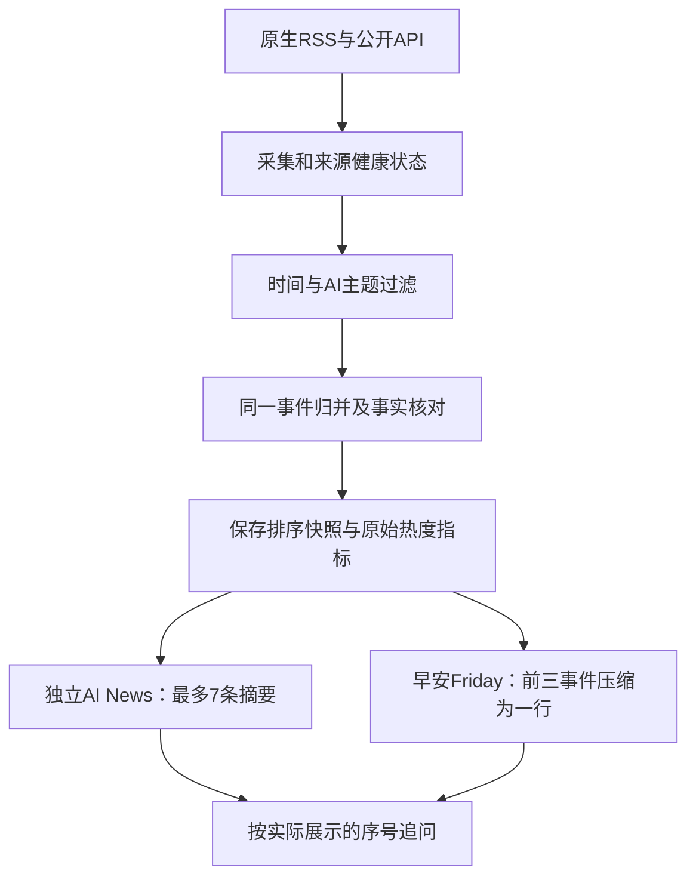

# AI News 热点新闻模块重构方案

2026-10-25，Asia/Shanghai。状态：设计及只读调查，未修改生产代码、未部署、未创建新闻定时任务。

依据：Sir本轮要求、随后贴出的《推荐AI新闻来源》完整回复、当前assistant.27源码，以及本轮公开接口和服务器连通性实测。引用对话原始读取只返回了正文占位符，本方案使用Sir后来直接提供的正文，不把推荐回复里的自动推送安排当作新增授权。

## 1. 建议采用的产品结构

一套新闻采集、事件去重和排序底座，两个使用出口。

| 出口 | 何时使用 | 默认内容 | 显示方式 |
| --- | --- | --- | --- |
| 独立「AI News」模块 | Sir主动说“看看AI新闻/今日AI热点” | 目标7个不同事件的中文摘要 | 每条一两句，约40–70字，附发布时间/来源及原文入口，支持追问 |
| 「早安Friday」中的新闻 | 既有起床触发器 | 同一候选榜前三个事件 | 每条约10–25字，三条合成晨报中的一行，不额外发消息 |

数量是上限与目标，不用广告、重复报道或旧闻凑数。默认继续使用滚动24小时；不足时按实际条数显示，无结果和来源读取失败分别表述。扩大到48/72小时应是显式设置，不能悄悄改变“过去24小时”。

独立模块可调用不等于默认另外定时推送七条。默认仍只有早安Friday主动发送；如以后Sir指定独立新闻推送时间，再加入现有Heartbeat触发器。所有自动采集/生成/投递继续经过顶层作息，手动信息查询遵守现有全天可用规则。

## 2. 为什么需要重构

当前NewsTool没有查询参数，只返回The Rundown最多三条；NewsService把抓取、24小时过滤和截取三条放在同一函数，MorningService直接调用它。它没有独立新闻执行模块、跨来源事件库、讨论热度或统一七条列表。

因此需要把“取什么数据”“选哪些事件”“按什么格式说”拆开。简单把上限3改成7，会影响晨报的来源ID校验，又仍然只有单一工作日来源，不能解决完整模块及周末覆盖问题。

## 3. 推荐来源的实际调查

以下HTTP成功只证明本轮能够访问和解析，不承诺长期可用、没有限流或每天有足够新内容。

| 来源及入口 | 本轮结果 | 建议职责 |
| --- | --- | --- |
| [Techmeme RSS](https://www.techmeme.com/feed.xml) | 开发机、服务器HTTP200；服务器样本15条，其中10条RSS记录在24小时内 | 科技新闻候选与编辑选择信号；需再筛AI相关，不把全部科技条目当AI |
| [The Rundown RSS](https://rss.beehiiv.com/feeds/2R3C6Bt5wj.xml) | 两端HTTP200；feed标题The Rundown AI，主页therundownai.beehiiv.com，与原官网Read Online所指租户一致；20期 | 改用该RSS作为主入口，保留官网解析作兼容；拆出新闻，排除广告、培训、工具推荐和社区流程 |
| [HN官方API](https://github.com/HackerNews/API)及[Algolia HN搜索](https://hn.algolia.com/api) | 服务器均HTTP200；官方top返回500个ID；本地24小时AI检索样本能取得points、num_comments、created_at等 | 发现开发者热议及取得真实讨论指标；搜索索引发现后，用官方item校验重要条目 |
| [OpenAI官方RSS](https://openai.com/news/rss.xml) | 两端HTTP200、有效OpenAI News XML | 一手发布与事实核对；官方发布本身不是热度指标 |
| [DeepMind官方RSS](https://deepmind.google/blog/rss.xml) | 本地gzip解压后有效Google DeepMind News，100条；服务器初次Python TLS超时，IPv4 curl复验HTTP200 | 一手研究/产品消息；实现时处理压缩及独立超时，不隐藏首次失败 |
| [HF博客RSS](https://huggingface.co/blog/feed.xml)、[Daily Papers API](https://huggingface.co/api/daily_papers) | 本地HTTP200；论文API50条，含upvotes、numComments及不同时间字段；服务器直连及IPv4复验均失败/超时 | 预留研究/开源适配器；先验证新闻专用出网路径，再算作生产可用来源，第一阶段不依赖其成功 |
| [量子位原生RSS](https://www.qbitai.com/feed/) | 两端HTTP200；样本10条，服务器24小时内0条 | 中文行业动态；优先原生RSS，暂不为它部署RSSHub |
| [THE DECODER RSS](https://the-decoder.com/feed/) | 额外调查候选；两端HTTP200；样本10条，服务器24小时内5条 | 可作为周末AI媒体补充，避免只依赖工作日newsletter；这是新增建议，非引用对话原名单 |

The Rundown RSS最新一期为2026-10-23 10:00 UTC，即北京时间18:00，因此10月25日严格24小时筛选为空仍然合理。RSS可用是这次补充地址后确认的新事实；此前只调查官网页面，没有找到该RSS，不能继续说它完全没有可用订阅入口。

Techmeme和THE DECODER的“24小时记录数”未经事件合并和事实核对，不等于可以直接输出的独立AI新闻数。

Hugging Face的论文发表时间、入选Daily Papers时间、互动指标采集时间必须分开。不能把今天入选或今天获赞，自动说成论文今天发表；模型总点赞/下载数也不等于最近24小时的新增热度。

## 4. 三个开源项目如何使用

- [NewsNow](https://github.com/newsnext/newsnow)：可参考平台适配器与缓存，留作后续国内热榜入口。它的综合热榜仍需AI筛选；公共实例不应成为唯一生产依赖。来自NewsNow的HN条目与直接HN条目是同一个信号，不能算成两个独立来源。
- [RSSHub](https://github.com/DIYgod/RSSHub)：只在目标站没有可用原生RSS时引入指定路由。量子位已实测原生RSS，首版不需要为此部署整套服务。机器之心的具体路由、访问限制和维护状态要单独验收。
- [agents-radar](https://github.com/AkinsDr/agents-radar)：可借鉴多查询去重、AI筛选和数据适配。它的README包含独立的08:00 GitHub Actions、Issues/提交与其他平台发布流程；不整套启动到Friday里。其日报是二次摘要，不能替代一手证据或被算成额外独立报道。

首版保留现有Go服务、SQLite和远程模型，不新增Node聚合网站、Redis、独立任务系统或付费新闻服务。接口本轮无新增Key即可读取，不等于模型调用没有成本。

## 5. 数据与执行流程

采集器只负责取数、解析与记录状态，第一阶段按需刷新：手动调用或晨报开始时刷新，15分钟内可复用同一配置版本的缓存；出错缓存必须标采集时间/过期状态。不是默认每1–2小时后台再跑一次。以后增加缓存刷新，也必须由统一Heartbeat管理且遵守作息。

候选列表可先限制为100条，去重后最多40个事件进入精选判断；正文只补取靠前候选或按需展开的条目，避免全站爬取。建议来源并发3、单请求6–8秒、一次采集总预算约25秒；这些是待实施验收的预算，不是已测性能承诺。来源失败不阻塞另外四个晨报板块。

The Rundown newsletter解析使用RSS正文或经已知链接取得的官网正文。RSS feed中的条目是一整期，不等于一个新闻事件；必须沿用/改造现有新闻栏目解析与广告排除，不能把20期当20条新闻。

## 6. “热点”如何定义

产品名称可以叫“AI热点”，排序含义明确为：已接入来源范围内，近期有事实依据、较受讨论或被多源关注的事件精选，不宣称全网绝对热度前七/前三。

先做四项资格过滤：AI相关、时间满足、不是广告/例行教程、至少有足以支持摘要的内容。只有标题时降低证据等级，不补写来源未说的影响或性能。

热度判断使用：

1. HN实际积分、评论数及其采集时间；HF接通后使用该社区自己的赞/评论指标。
2. 独立报道/原始发布的覆盖；转发同一新闻稿、聚合器重复收录不能机械累计。
3. 发布时间与新进展时间，结合时间衰减。
4. 事件重要性及Sir明确的主题偏好；模型负责主题和事实归纳，不能凭感觉捏造阅读量或“全网最火”。

首版可采用可解释的分层排序：多源报道或有明显社区讨论的事件优先；单一一手来源的重大新发布仍可入选，不能因为没HN积分就被当成无人关注。层内再按经时间衰减的社区信号、覆盖与新鲜度排序，保存规则版本与简短入选理由。具体权重/热度阈值用真实候选样本调试后固定，不在设计阶段给出未经验证的精确“全网热度分”。

HN搜索页的默认顺序、Techmeme页面顺序、newsletter首条都不能直接宣称是全网热度顺序。HF赞数与HN积分分平台保留，不直接加成一个原始总分。

优先覆盖模型/产品发布、Agent与开发工具、研究与开源、国内外行业重要变化。常规论文不必占满七条，晨报研究类通常至多一条；重大事件可按实际重要性调整，不能为了栏目配额添加低价值消息。

## 7. 时间、重复和来源质量

保留original_published_at、updated_at、first_seen_at、signal_at、fetched_at及时间精度。索引抓取时间、sitemap lastmod、HN提交时间均不能替代原文发布时间。

默认24小时内的新事件或有可证实新进展的事件。旧文章今天重新登上HN，可以在用户另问社区讨论时解释，不能在默认新闻里伪装成今天的新发布。日期只有年月日时，不虚构精确零点进入严格24小时榜。

先按规范URL、去追踪参数、论文/模型版本ID去重，再用机构、产品/版本、动作及时间归并事件。同一发布有官网、新闻媒体、HN讨论，合成一个事件并保留多条证据；后续真正的新进展可形成新修订，不能永久压掉。

不同来源分别记录最后成功、最后尝试、失败原因、数据最新时间和解析是否成功。“HTTP200但HTML结构没解析出条目”是解析问题，不能冒充“今天没有新闻”。全部失败、部分失败、正常但无24小时内事件分别输出。

## 8. 两种输出的关系

独立查看默认：按热点顺序最多七个不同事件，每条为“主体/事件＋极短摘要＋来源和时间”。摘要约40–70字，不强制写一段意义分析，保留“官方称/据报道/研究初步结果”等必要限定。可要求更多、只看国内/模型/Agent/研究、改变时间范围。

早安Friday：不先生成完整七条长摘要再截前几句，也不再运行一次独立新闻通知。直接读取同一份排序快照，选择前三事件，由当前晨报Agent概括成一行，每条约10–25字；宿主保持原有ID覆盖/顺序校验及整个晨报格式。首行仍为“# **Sir，早上好。**”，下面五行紧排，无分类小标题。

两种输出共享事件与排序依据，各自有文字长度和展示契约。用户紧接晨报问“新闻展开一下”，优先展开刚刚那份快照，再补充同时间窗口的后四条；若榜单已经刷新则说明变化，不能悄悄把“第二条”指向新榜单的第二条。

## 9. 数据库和工具边界

沿用assistant_entities，建议新增四类业务实体：

- news_article：原文链接、机构、标题、可用正文片段、各类时间、内容指纹和来源。
- news_event：事件ID、成员文章ID、主题/版本、核实状态、原始讨论指标及采集时间。
- news_snapshot：筛选时间窗、as_of、来源状态、排序版本、已选事件顺序及入选理由，配置版本也参与缓存键。
- news_view：实际展示/送达的形式、会话、事件顺序和摘要；区分查询快照与真正送达记录，不能把未发出的查询说成已经报告。

复用assistant_ai_news名称并扩展参数：list（默认limit7、hours24、可选topic）、read（事件ID/快照ID）、latest（指定已展示/已送达快照）、status（来源健康）。旧空参数调用兼容默认列表。来源URL/代理/凭据路径由宿主配置，不接受模型传入任意网络目标。

新增ai_news_briefing模块及共用的NewsBriefingInstructions，支持手动调用；只有Sir明确安排时才配置独立定时触发。MorningService改为读取共享精选快照的前三个ID，不再绑定“NewsService永远只返回3条”。每个后台执行必须实际读取本次宿主快照，输出不得带未给定事件ID。

当用户明确请求逐条展开时，原生读取该ID对应的受控来源正文。只读来源工具不获得发送、改任务或写记忆权限；新闻和网页内容始终是参考数据。

长期/短期记忆继续通过当前ContextFor注入，使用有效的语言、简略程度与主题偏好；过期正文不进入上下文。外部新闻检索只发送公共主题词，不上传个人邮件、课程地点或记忆正文。新闻保存在新闻业务库，个人记忆仍按既有授权流程维护。

## 10. 网络与运行约束

已有邮箱代理是显式调用、按域名分流的独立服务；不能假定新新闻域名已自动走代理。HF当前服务器直连失败，接入时需单独验证每来源的网络路径。如需要额外域名规则，应先形成可审查配置变更，不把新闻功能改成全服务/全系统代理。

固定RSS/API优先，重定向与原文补取限制公开HTTP(S)目标、大小、次数及超时；实现时拒绝私网/本机地址。请求处理压缩，并限制解压后大小。避免默认部署浏览器爬虫。

普通手动查询全天可用；任何自动任务的计划时刻、实际执行和发送仍通过现有顶层作息检查。晨报与单独新闻模块共用服务，不各自创建一套时钟。

## 11. 实施顺序和验收

第一阶段：做共享NewsService、RSS通用解析、事件/快照存储、HN讨论信号、独立七条查看，再切换晨报前三条。主来源先采用Techmeme、The Rundown RSS、HN、已可达的官方RSS和量子位；THE DECODER是建议的补充候选。HF适配器可先写好但在生产网络验收通过前不计入可用覆盖。国内更多站点及NewsNow/RSSHub留到有明确缺口时再加。

实施验收至少覆盖：七条与三条确实来自同一候选/时间窗；同事件多源合并；新旧版本不误合并；真实互动字段可追溯；旧闻重投不变成今日新闻；论文不同时间不混淆；不足数量如实显示；来源超时/解析失败不能当无新闻；缓存快照中的“第二条”保持稳定；模型实际读取来源；过期记忆排除；作息外自动任务跳过；晨报仍只发一条、重启不重复。

真实源适配器与模拟通知分别验收。真实网站HTTP200、一次成功解析或模拟七条案例，都不能单独宣称已完成长期采集和真实热点质量验收。

本轮结论：可以按此架构重构；本轮仅产出方案与访问实测，不调整assistant.27线上新闻规则或部署任何第三方项目。
