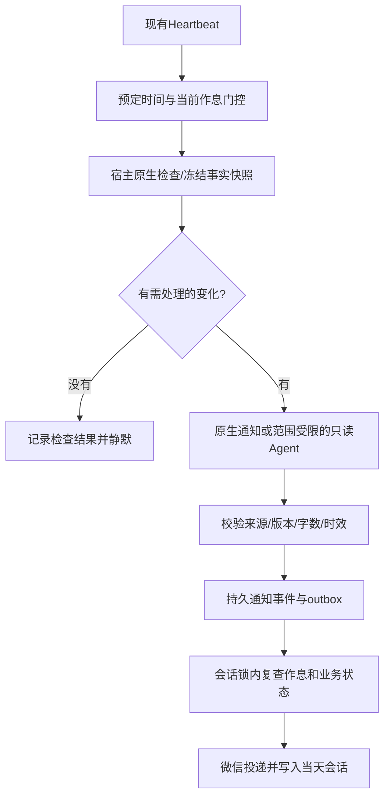

# Friday 私人助理扩展：九项需求技术调查与实现设计

日期：2026-10-25（Asia/Shanghai）；2026-10-26收尾补充状态：**R1/R2/R3/R4/R8/R9六项已随assistant.34实现并部署；R5天气变化提醒、R6 GitHub PR跟踪仍未实现；R7日历暂缓。** 第1–19节保留实施前调查和方案的历史时点，实际实现差异及已确认默认值见第20节与源码verification/SIX_FEATURES.md，不能把正文中的拟议接口、实体或“未实施”误作当前状态。

初版调查只读源码、生产调度配置和官方资料，并对公开天气网页做有限的连通性调查；只新增本文及研究证据摘要，没有修改业务代码、生产配置、数据库、凭据或提示词，也未创建任务、调用模型或发微信。本轮按Sir要求将固定提醒自然表达补为R9并统一修订文档，仍不实施下述功能。其间曾按独立明确指令移除一条无用生产记忆，这不代表记忆机制或九项功能已修改。工作区已有assistant.33发布相关修改也不属于本轮实现。

## 1. 需求基准与范围

用户最新纠正优先于此前讨论。以下“确定需求”来自 Sir 的明确要求；涉及频率、提前量、字数、保存期等尚未明确的数值均标为“建议”，不能据此直接上线。

| 编号 | 确定需求 | 本次设计范围 |
| --- | --- | --- |
| R1 | 周一/三/四从09:50开始；周二/五08:00、周末11:00保持；全部23:30结束 | 更新统一每周作息，不改变门控语义 |
| R2 | 邮件中发现待办先问，Sir要求后才写入正式待办并安排提醒 | 候选提取、确认关联、原子创建、来源与去重 |
| R3 | 每天23:00固定睡前总结，包含简短关照；措辞结合真实情况变化 | 独立晚间模块、真实快照、只读记忆、固定时钟 |
| R4 | 截止事项跟进，区分已提醒与已完成 | 一事项多提醒、完成/延期失效、受作息约束 |
| R5 | 突发天气预警提醒，优先免费的官方来源；节省每月5000次额度 | 官方源实测、适配器、变化检测、限额与降级 |
| R6 | 跟进自己提交的GitHub PR | 公开PR优先，评论/审核/CI/状态增量，按需查询 |
| R7 | 日历同步暂时不需要 | 明确暂缓：不接Google Calendar、不增加授权或调度 |
| R8 | 会员、域名、服务器等到期提醒 | 到期台账、提醒计划、续期更新、与邮件候选关联 |
| R9 | 固定提醒像私人助理直接说话；创建时由AI写好，到点由程序发送 | 区分确认与通知文案、自然表达校验、实际报时、沿用门控与去重 |

R2纠正：本稿不采用“邮件一出现就自动创建待办”的旧理解。候选记录不是正式待办，也不会生成可执行的提醒任务。R3保留自然变化的表达原则。R5将“官方预警”与“分钟级降雨预测”分开：本轮首版只设计前者，普通临近降雨另行决定。R7不计入本轮待开发功能，但保留在九项需求中以防被重新加入。R9方案已获Sir认可；本轮指令是将其纳入统一设计并概括重点，尚未执行代码修改或部署。

所有新自动功能继续遵守：**预定事件时刻和执行/发送时刻均符合当天作息；窗口外的发生实例跳过，不顺延；前台主动查询全天可用。** 不为高等级天气或PR消息擅自增加夜间例外。

## 2. 当前系统核验与可复用边界

### 2.1 实际基线

本次只读核验生产为 `v1.39.10-assistant.33-editorial-style`，`mybot-heartbeat.service` active。Git HEAD为 `b574332a490a830af673fbe91e42b9dce4c89a0d`，其后已有未提交的assistant.33提示词和发布记录；不能把该HEAD称为已完整包含assistant.33的提交。

生产Heartbeat revision=25，目前仍为周一/三/四10:00开始、周二/五08:00、周末11:00，全部24:00结束，未应用R1；无日期覆盖。现有三个启用触发器：morning→morning_briefing、daytime_mail→mail_check（60秒）、course_classes→course_reminder（课前10分钟）。新功能均尚无触发器。

### 2.2 代码事实与设计影响

源码相对于仓库根目录的路径如下：

| 位置 | 已有实现 | 对本轮的影响 |
| --- | --- | --- |
| `reasonix-assistant-v1.39.10/internal/assistant/repository.go` | SQLite WAL、短事务、进程间锁；`assistant_entities(kind,id,payload)`，schema version=1 | 新业务实体可用独立kind；网络与模型不得占用事务或锁 |
| `internal/assistant/heartbeat_config.go`、`heartbeat_mutations.go` | 模块目录、统一每周作息、按日覆盖、revision | R1走已有工具；新模块需注册，不能只改提示词 |
| `internal/assistant/routine_admission.go`、`heartbeat_runtime.go` | 预定时间、当前时间、模块/实例状态门控 | 所有新模块与提醒复用，禁止旁路 |
| `internal/heartbeat/engine.go`、`admission.go`、`task.go` | message/agent/mail_check/weather_check种类；运行中复查；引擎串行并持有执行lease | 新原生检查器必须扩展校验与分派；不能凭空使用新kind；轮询频率不等于硬实时保证 |
| `internal/cli/heartbeat_runner.go`、`heartbeat_conversation.go` | 后台子进程、能力范围、读取回执、发送前门控、当天会话上下文 | 新Agent模块沿用后台只读、有效记忆和当日会话链路 |
| `internal/bot/assistant_proactive.go`、`internal/assistant/notifications.go` | 持久outbox；prepared/sending/sent/delivered/uncertain；sent仅补写会话 | 不绕开发微信接口；发送不确定不自动重放 |
| `internal/assistant/tools.go` | `allowMutation`拒绝后台修改任务/记忆 | R2保留这一限制，用户确认后由前台写入 |
| `internal/assistant/types.go`、`tasks.go`、`task_changes.go` | Todo有planned_for、due_at、单个JobID；普通todo不能通过update直接加提醒 | R4需要显式的一对多提醒扩展，不能假定现成支持 |
| `internal/assistant/tasks.go: makeJob`、`internal/heartbeat/engine.go` | message把Body/Title保存为Prompt，到点原样作为Execution.Text，不调用Agent | R9先规范创建时通知正文，需要报时再用受限原生渲染，不能期待通用聊天提示词在到点生效 |
| `internal/assistant/mail_sync.go`、`mail_receipts.go`、`mail_digest.go` | 邮箱游标、跨副本去重、逐封决策、完整正文分页读取回执 | 候选提取嵌入同次分析；不重置游标、不重扫历史、不按未读标志决定是否处理 |
| `internal/assistant/morning*.go`、`context.go` | 程序组装晨报；当前/未来有效记忆与过期边界 | 晚间模块复用数据服务，不复制晨报的全部外部请求 |
| `internal/assistant/weather_query.go`、`weather_http.go` | 已有官方alerts查询，缓存5分钟；briefing默认包含多种组件 | 预警轮询只取alerts；不能每次调用整份briefing |

表中省略前缀的 `internal/...` 均位于 `reasonix-assistant-v1.39.10/`。以上是源码与现场配置核验，不代表新模块通过验收。

## 3. 统一架构与数据契约

### 3.1 执行流程



计划新增模块ID：`evening_briefing`、`deadline_check`、`weather_alert_check`、`github_pr_check`、`subscription_check`。邮件候选提取属于现有mail分析/晨报读取流程，不另启一条邮箱轮询；日历不注册模块。名字是拟议契约，当前版本不能调用。

新增宿主内部 `module_check` 任务种类，由固定ModuleID映射到原生服务；需修改Task.Validate、Engine.Tick种类列表、runAdmitted、CLI Checker路由与门控映射。它不接受模型提供的URL、shell命令、提示词路径或接收人。首次实现可让deadline/subscription共用一个有界原生扫描服务，仍保留独立模块开关。

原生module_check的Capability保持空，由宿主ModuleID允许列表决定行为；不能把它标成现有weather Capability，因为当前校验要求weather必须是只读通知Agent。evening与github分析如增加新Capability，须同时加入Task.Validate的允许集合与只读Agent条件、CLI环境标记和boot后台scope；内部github_pr_analysis在门控中映射回github_pr_check，仿照mail_analysis。`configureUnifiedHeartbeat`当前直接把Checker设为邮箱runner，新增路由必须保留mail_check分派，不能覆盖后使邮件检查消失。AfterDelivery也要增加晚间等新模块的确认回执。

现有引擎会被长Agent执行占用，不能保证检查精确到秒。建议将待发送的固定提醒、短原生检查优先于较长分析分派；新分析设置60–90秒级预算、检查批次设置请求上限并保存续查游标，仍保持单个受控执行者。不在本轮引入Redis、常驻浏览器或另一套cron。改变分派顺序必须回归既有邮件和晨报公平性。

### 3.2 建议新增的持久实体

继续使用 `assistant_entities`，按kind定义版本化JSON；不立即扩大通用schema版本。拟议字段如下，均为设计，不是数据库迁移脚本：

| kind | 关键字段与约束 |
| --- | --- |
| `task_proposal` | id/revision/source_refs/source_fingerprint/title/due_at/date_precision/reminder_draft/evidence_quotes/state/created_at/confirmed_task_id；后台只可登记候选 |
| `task_reminder_plan` | task_id/revision/task_revision/rules/occurrence_ids；正式事项一对多提醒 |
| `task_event` | task_id/event_id/type/at/user_message_ref；准确记录完成、延期、重新打开，不以UpdatedAt冒充完成时间 |
| `business_notification` | stable_event_id/source_kind/source_ref/source_revision/immutable_text/state/expires_at/outbox_ref；跨重试去重 |
| `evening_snapshot`、`evening_result` | date/as_of/source_refs/task_revisions/tomorrow_courses/effective_memory_refs/validated_output |
| `weather_alert_snapshot`、`weather_alert_event` | provider/region/source_id/issuer/event_type/level/issued_at/effective_at/expires_at/change_type/observed_at/raw_hash |
| `api_usage`、`source_health` | provider/billing_period/resource/attempts/reserved_budget/last_success/failure_count/next_attempt_at；记录实际外部请求 |
| `github_pr_watch`、`github_pr_snapshot`、`github_pr_event` | host/repo/number/author/head_sha/checks/reviews/comment_cursors/baseline/event_state |
| `subscription`、`subscription_occurrence` | id/revision/name/expires_on或expires_at/time_precision/renewal_mode/reminder_rules/period_id/source_refs |

所有实体由宿主绑定owner；模型不能切换owner或自行挑选数据库路径。网络读取→解析→短事务提交；涉及用户确认和多个任务的写入要在一个事务内完成。耗时任务的输入快照冻结，发送前再检查相关revision，避免完成或延期后仍通知。

### 3.3 通知去重和投递语义

业务事件ID必须稳定，例如 `hash(owner,source_kind,source_id,semantic_change,occurrence)`，不能把尝试次数或模型运行开始时间当作新业务事件。任务历史仍按attempt保存，业务事件通过独立关联表/实体映射到outbox身份；现有Sender使用job:startedAt的路径需要增加可选稳定通知ID，旧任务保持兼容。

第一次生成的通知正文冻结；同一业务事件重试读取已存正文，不重新改写后撞上Notification identity conflict。仅平台明确失败时按现有策略重试；sending/uncertain不自动再发；平台成功但会话导入失败只补导入。同一邮件同时出现在晨报与白天分析时，共享proposal和business_event身份。

轮询游标、观察到事件、准备通知、实际送达是不同状态：完整页面/批次解析并持久化事件后才能推进采集游标；送达前不能标记已通知。失败不能伪装成“没有变化”。

### 3.4 工具与记忆

前台拟增加：`assistant_proposals`（list/get/approve/reject/edit）、`assistant_deadlines`（preview/get/set_reminders）、`assistant_evening`（preview/latest）、`assistant_github`（add/list/query/remove）、`assistant_subscriptions`（create/list/get/update/renew/archive）。天气变化查询可扩展现有assistant_weather，而不是再创建一个模型随意联网工具。

后台只开放本模块固定读取工具和宿主快照；统一保留任务/记忆写限制。候选登记等内部审计写入由宿主在校验Agent输出后完成，不把任意后台写权限交给模型。新增工具需要同步boot注册、能力发现清单、read-only契约和后台scope测试。

各模块获取现有有效长期/短期记忆。未来记忆现在可见但仅在对应日期适用，过期/归档正文不得从历史恢复。业务事实以数据库/真实来源为准；私人正文不进入公开研究日志。通知进入实际发送日的日常会话，06:00会话边界不改变业务自然日。

## 4. R1：统一作息调整

目标配置为周一/三/四09:50–23:30、周二/五08:00–23:30、周六/日11:00–23:30；时区Asia/Shanghai，开始包含、结束排除。

实施时先通过assistant_heartbeat get取得最新revision，合并未请求改动的启停值、触发器和日期覆盖，再用set_weekly一次写入完整七天；不能覆盖整个config.toml、重新Ensure成默认值或逐行制造一半新一半旧配置。提交后重新get核验实际保存值；若revision冲突，重新读并确认差异，不能盲目重试覆盖。

具体影响：morning未设置独立clock，随新的起点运行；course_classes继续按课程本身倒推10分钟，不能跟随起床时间移动；daytime_mail仅改变可执行窗口。23:30前开始但尚未发送的长分析，越过结束时间后停止或过期。固定23:00晚间事件若被某日覆盖排除，跳过，不能改到次日。

仅有每周配置更新就能完成R1，不需要重编译二进制；本次设计阶段不执行。迁移当天若晨报已经发过，不因起点从10:00改09:50而再发一次；历史已送达实例不重建。未来新增模块仍由同一配置门控。

## 5. R2：邮件发现事项 → 询问 → 用户确认 → 待办和提醒

### 5.1 提取和询问

复用已读邮件正文及mail_read_receipt，给现有邮件分析/晨报输出契约增加可选 `task_candidates` 字段。每个候选包含宿主已知mail_ids、事项短标题、正文原句证据、明确的截止时间或日期精度、建议提醒时间、缺失字段。程序校验ID确实属于本批且读取完整；外部正文不是授权。

候选提取在邮件原有通知偏好筛选后进行。被现有规则判定静默的邮件，首版不另发“是否建待办”的推送；用户主动查看静默汇总并要求处理时可以生成候选。不能用候选提取重新放行广告、推广等已过滤邮件，也不自动扫描全部历史。

候选先保存在 `task_proposal`，不写正式todo、不创建job、不进入晨报待办数。需要持久候选是为了跨会话确认和重启恢复；这属于待确认草稿，不等于替用户接下事情。建议最多保留30天未处理候选，或截止已过后转过期，保存精简审计信息；具体保存期是建议。

候选还需保存analysis_job_id/attempt与实际阅读回执。只有完整邮件分析通过宿主校验后才成为可展示候选；失败尝试的半成品不能出现在待确认列表。实际送达的询问或前台展示记录绑定proposal_revision/draft_digest；approval不能指向从未展示、模型自行替换的草案。

询问合并在原邮件通知中，例如“Sir，有封邮件要求周五18点前交材料，要我记成待办，并在周五15点提醒吗？”既说明事项，也给出实际提醒时间，Sir一次确认即可覆盖两项。

晨报仍严格六行：在邮件那一句内简短问是否记录；来源、候选ID与完整提醒草案保存在送达快照中供追问。不得为了询问另塞第七行。若一句话容不下明确提醒安排，先问是否记录，后续对话再补齐时间，不能从一句“好”推断用户同意未展示的计划。

### 5.2 确认状态机与事务

```text
detected → pending_confirmation → approved → converted
                         ├──────→ rejected
                         └──────→ expired/superseded
```

前台approve必须关联真实用户入站消息、候选ID、候选revision和已展示草案digest。仅由模型填approved=true或邮件中写“同意”不成立；后台approve一律拒绝。宿主在受信调用上下文绑定本轮用户消息及owner，而不是接受模型提供的聊天ID。

只有一个已展示、未改变的候选时，“好，帮我记下”可以结合会话关联确认；多个候选或“好”指代不清时询问。草案内容、截止或提醒时间已变更时重展示，旧确认不适用于新revision。确认消息引用应可追溯，已消费的确认重放也必须幂等。

转换在单一事务中完成：检查proposal未转换/未过期→重新校验截止、时区、作息→创建Todo与提醒计划及其job→写来源链接和批准审计→proposal=converted并记录task_id。创建任何一步失败全部回滚；超时后重试查converted结果，不生成第二套任务。

### 5.3 时间、重复与变更

- 截止时间与提醒时间分开保存，planned_for也独立；“本周五前”没有明确钟点时不能伪造18:00或23:59。
- 建议默认提前量仅作为待确认草案。没有用户接受的通用策略时，每次询问中展示拟定时间；正式创建前校验提醒未在过去且位于允许窗口。
- 用户指定的窗口外提醒不能顺延；说明该时间不会运行，并请其选择允许时段。未确认的新候选可建议合法时间，不能把已经约定的事件静默改时。
- 首层使用已有邮件Dedup/Message-ID；同一业务跨邮件匹配再结合来源机构、业务标识和证据。模糊相似不能直接合并，尤其不同课程或不同报名。
- 截止延期等后续邮件先生成更新候选；用户确认后修改正式事项与全部未送达提醒，不因为新邮件单方面覆盖已确认安排。
- 用户拒绝后同一证据不重复问；有实质新要求或用户主动要求时才重新提出。

## 6. R3：每天23:00睡前总结

新增evening_briefing及daily触发器 `evening`，拟议参数 `clock="23:00"`、`routine_bound=true`、`catch_up_seconds=300`。建议通知有效期为 `min(23:10, 当天作息结束)`；错过则保存跳过原因，次日不补。日常23:30结束满足触发条件，但未来日期覆盖仍优先。

### 6.1 输入和输出

宿主冻结：今天仍未完成且计划今日/已截止的待办、未来24小时迫近期限、明天实际课程的最早时间/必要地点、已确认的其他明日安排、当前有效记忆。数据源缺失与空列表分别表示；无需查询新闻、天气或再次全量轮询邮箱，不复制晨报Prepare的全部外部请求。

建议输出3–4个紧邻短段，总计约80–160字、硬上限200可见字符：今晚剩余事项一句，明日最早安排一句，关照一句；事项太多仅列最重要2–3项并说明数量。无待办也固定发，课程未知不说“明天没课”；未有可靠完成日志时不编造“今天完成了N件事”。这些字数和布局为建议，不是用户已明确的六行要求。

自然表达由Agent结合事实组织；提示词给信息取舍原则及不同情况的示例，不固定轮换几个模板。只写温和关照，不假装知道用户是否已经躺下、是否失眠或实际身体情况。保留最近几次结尾的短文本作为避免机械复述的参考，模型可以自然复用必要事实，不能为了不同措辞发明事情。

拟议结构化输出 `{"remaining_task_ids":[],"tomorrow_fact_ids":[],"care":"短关照","message":"正文"}`；程序核验ID、字数及事实存在，发送前再查任务状态和课程revision，已完成事项删去/重新组装。后台工具只允许读取；未生成合格文字时使用程序依据已确认事实组成的简短降级正文，不能把失败记成“无事项”而漏发固定总结。

仅“ID存在”不能证明自由正文里的时间/地点正确，因此message只作草稿：课程名称、开始时间、教室和事项截止由宿主槽位绑定，Agent可选信息与组织简短关照，不能改写数值。若自由草稿与冻结事实无法核对，使用槽位渲染；care不得夹带未提供的行程、完成结论或身体状态。避免机械措辞的要求服从事实可靠性。

手动 `preview`直接在当前对话返回预览，不消费或重放当晚自动发生实例；`latest`读取实际送达版本，支持追问。23:00自然日与当日06:00会话归属各自独立。

## 7. R4：截止事项跟进与一事项多提醒

### 7.1 现有模型需要补足的部分

当前Todo仅有一个JobID，complete/pause/update只修改这一job，普通todo还不能直接加schedule。因此不能通过提示词声称已经支持“同一事项提前一天、两小时、逾期再跟进”。

建议引入 `task_reminder_plan`，用task_id关联多个规则与独立发生实例；TaskView增加reminders数组，原Schedule/JobID仅兼容旧版的一项提醒。增加显式attach/set_reminders操作，复用原Tasks.create校验和宿主target绑定，禁止让模型直接拼job实体。

每个实例记录task_id、task_revision、plan_revision、rule_id、scheduled_at、expires_at、status。稳定ID=`hash(task_id,plan_revision,rule_id,occurrence)`。计划revision仅在用户改变提醒安排时增加；普通检查与进程重启不产生新ID。

### 7.2 处理规则

| 事件 | 原生处理 |
| --- | --- |
| 创建/批准提醒计划 | 明确展示事项截止、每次提醒时刻；同一事务写事项与实例 |
| 送达提醒 | 写delivery事件，事项仍open，不自动complete |
| 用户完成/取消/暂停 | 原子更新Todo并禁用关联的全部待发送实例；发送前再核对 |
| 用户延期/修改截止 | 标记旧计划实例superseded，保留历史；计算并确认新计划 |
| 用户只说“稍后” | 不猜新的提醒钟点；自然询问 |
| 正文未明确时间/只有日期 | 使用日期精度，不转成伪造精确截止；提醒时刻单独确认 |
| 预定提醒在作息外/已经过期 | 记录skipped，禁止改到下一次起床补发 |
| 用户重新打开已完成事项 | 新revision和明确的新计划；旧已送达实例不恢复 |

建议提供“单次提醒”和“截止跟进”两种可选策略，默认不反复催促。多阶段提前量、逾期是否再问以及冷却时间，需要用户接受后才生成；逾期跟进不是每分钟扫描一次就每分钟发一次。晨报、睡前总结可以继续简短包含未完成事项，但不能冒充新定时提醒或暗自增加催促次数。

原生deadline_check建议每5分钟仅扫描本地状态；精确提醒仍由已有message job到点执行，不等待5分钟扫描。扫描只负责发现失效计划、补齐已批准的未来实例和执行健康核对，不依赖LLM判断截止是否已到。需给Todo变更、job与outbox增加关联业务版本校验，堵住“列表读取后用户刚完成”的竞态。

## 8. R5：官方天气预警来源、免费额度与变化提醒

### 8.1 调查结论与证据边界

本次没有发现已被生产服务器验证可稳定使用、具公开开发者契约的上海免费预警API。发现了官方网页内部使用的数据端点，但连接失败；不能承诺直接换源后即能稳定运行。搜索索引中旧的“当前无预警”不是实时结果。

| 来源 | 本次实测/资料 | 结论 |
| --- | --- | --- |
| [上海市气象局灾害预警页](https://sh.cma.gov.cn/sh/tqyb/zhyj/) | 本地和腾讯服务器均200，但HTTPS跳转HTTP；正文为动态外壳 | 只能证明页面可达，不能把空壳解析成无预警 |
| 同官网页面引用的 `Smb.js` 与 `GetAlertListByType?type=sh` | 读取官网JS确认真实地址为 `http://smb.shweather.cn:5678/smb/Home/GetAlertListByType?type=sh`；腾讯服务器12秒超时 | 非臆造接口，但不具可用性证明、无已验证SLA，HTTP也降低真实性保障；不作为默认生产源 |
| [上海天气发布当前预警](https://wx.soweather.com/wxapp/warn.jsp) | 本地TLS失败，腾讯服务器DNS解析失败；搜索结果含历史预警 | 不可把缓存/历史项当当前预警；暂不接入 |
| [中国天气预警页](https://e.weather.com.cn/warning/warning.shtml) | 页面及其JS200；JS引用 `product.weather.com.cn/alarm/grepalarm.php`；对应公开请求本地/服务器403 | 没有拿到可验证数据；不通过换UA、伪造凭据或绕过限制继续尝试 |
| [中央气象台预警信号页](https://www.nmc.cn/publish/alarm.html) | HTML200，发现页面内部findAlarm调用；页脚明确限制未经授权下载使用 | 可人工查阅；不能将“可访问”写成已授权的免费后台API，首版不默认采集 |
| [和风官方预警接口](https://dev.qweather.com/en/docs/api/warning/weather-alert/) | 当前项目已有调用、5分钟缓存；文档提供发布者、时间、更新/取消等字段 | 技术上可复用，需总额预算，不能当无限免费源 |

上海官网内部JS引用可从[官网Smb.js](https://sh.cma.gov.cn/material/Static/js/Smb.js?20190726)复核。此次失败只说明当前探测环境下不可用，不证明服务永久下线；未做持续可用率测试、站点授权确认或真实预警的新增/解除全链路测试。研究证据摘要见同目录 `FRIDAY_ASSISTANT_EXPANSION_RESEARCH_EVIDENCE_2026-10-25.json`。

### 8.2 推荐实现路径

定义宿主 `OfficialAlertProvider.Fetch(ctx, region, validators) → AlertSnapshot`。每个适配器报告complete/current/unknown、采集时刻、上游更新时间和来源URL；HTML与JSON解析固定允许字段，不执行JavaScript/JSONP，不让模型自由抓页面。公开源启用前需取得可接受的使用条件，并从实际服务器完成连续24–48小时观察、有效/无预警/解除样本校验；不在本次设计阶段自动开展后续监测。

优先路线是继续验证上海官方可用数据渠道或申请其公开数据服务；验证通过后作为主源，和风仅对疑似新变化做低频交叉核验。若仍不可用，可选择预算内的和风alerts单接口轮询。两种路线由用户决定是否启用，不能在免费源失败后静默增加付费调用。

HTTP内部接口不得靠关闭证书校验来“修好”，也不为它放宽新闻模块现有HTTPS/SSRF防护。若未来经授权采用HTTP公共源，使用独立固定域名/端口允许列表，不传个人信息，发生新警报时必须通过可靠来源核对；没有验证条件时维持未启用状态。

### 8.3 5000次/月预算模型

5000次是Sir提供的账户限制，本次未登录控制台核实具体套餐、产品分桶、扣费规则或当月已用量；不能据估算承诺零费用。设计必须按账户所有请求统计，而非只数新模块。

新作息每周总运行5820分钟。以一个地点、每次一个接口计算，10分钟轮询约582次/周，30天平均约2494次；如果再全时轮询一个降水接口，已接近4989次，还没算晨报、手动查询、重试与月份长度。此前“每10分钟查一次”没有覆盖这部分总量风险。

当前view=briefing默认涉及current/daily/hourly/air_current/air_hourly/alerts/minutely/indices/history，不能把一次工具调用当作一次外部计费请求。预警检查明确只取alerts，并复用同地点、同时间段缓存。

建议备用配置为alerts每30分钟：平均约831次/30天；按最长15.5小时×31天的保守上界约961次，跨起点及取整可预留1000次。对比10分钟轮询显著节省额度，代价是最多约一个轮询周期加上游/调度延迟，不能叫“实时到秒”。若免费官方源通过验证，可用它作10分钟检查，和风仅在变化时核验。

拟议账户预算：`monthly_limit=5000`、`background_alert_reserve<=1000`、`hard_stop_before_limit`与保留余量；精确余量要在实施前读账户规则确定。每次真实HTTP尝试前短事务预留额度，含失败/重试保守计数，缓存命中不计；不同进程共用计数，防并发透支。按供应商账期重置，不能擅自假定本地月初；已有其他客户端用量未知时本地计数只是下界，需预留或以控制台为准。

免费网页检查也需限速与退避；ETag/Last-Modified只在上游支持且确实反映数据时使用。网页304不意味着和风不计费，接口版本号不意味着数据没变。403/429/TLS/DNS连续失败触发熔断，不高频重试或无提示地换付费源。

### 8.4 预警状态、地域与投递

标准字段：source_id、issuer、event_type、level、issued_at、effective_at、expires_at、source_url、description_hash、change_type、area_codes/geometry、observed_at。保留更新与取消的supersedes链；发布时刻不是天气开始时刻。[和风预警语义](https://dev.qweather.com/en/docs/api/warning/alert-guide/)提供相应时间与状态说明。

地区由当天有效记忆、明确行程及配置候选决定；不是实时GPS。市级影响上海的预警可命中，区级只命中已知相关区；地点不清不能随机发送其他区警报。上海以外行程若免费适配器不覆盖，报告覆盖不足或按已接受的备用策略处理。

只对新发布、等级上升或防范事项实质改变产生通知；发布时间格式变化或抓取时间更新不构成新事件。默认不反复播报同一预警。建议对已提醒的高等级预警解除发一条简短恢复消息，具体是否启用待确认。超时或列表解析不完整不能判断解除；只有明确取消、已知有效期已过，或完整当前列表和文档契约支持时才能更新状态。

预警ID、地区、等级、有效期由程序核对；首版可用原生模板概括，附真实发布机构、发布时间与原文链接，避免让模型修改预警性质。正常无变化不调用模型。已有预警在作息开启时仍有效的，可作为“当前仍有效”新观察状态提醒一次；夜间已发布又解除的事件不补发，不把夜间历史伪装成新预警。所有通知继续受作息门控。

**不在本轮首版启用分钟级降水轮询。** 免费官方预警能告诉Sir发布了什么预警，不能替代“15分钟后下雨”的临近预报能力。

## 9. R6：GitHub PR跟进

### 9.1 接入与授权选择

首版只读、以明确添加的公开PR为主。用户说“跟进这个PR”后保存host/repository/number；可选按确认过的GitHub用户名发现新公开PR，再提供跟进清单。不能把Codex桌面的GitHub连接当作服务器已有凭据，也不直接复制桌面令牌。

推荐从公开资源GET开始，服务器使用独立授权以获得合理额度。自有/组织仓库可选GitHub App或细粒度令牌；跨多个外部开源仓库时要逐项验证权限覆盖。若采用通知收件箱加速，官方Notifications API明确只支持classic PAT，需notifications scope；不能宣称任意fine-grained token能用该接口。[官方通知接口](https://docs.github.com/en/rest/activity/notifications)

私有仓库另行明确范围与权限，首版不默认扩大到repo scope。检查端点的权限以端点文档与实际只读探测为准；GitHub通用token限制页与具体Checks读取页存在表述差异，不据通用说明武断保证可访问。令牌存已有受保护secret/env机制，日志只记认证状态，不记header/token。

### 9.2 具体接口与归一化字段

| 接口 | 用途与关键字段 |
| --- | --- |
| `GET /repos/{owner}/{repo}/pulls/{number}` | state、merged/merged_at、draft、head.sha、review_requests、updated_at |
| `GET /repos/{owner}/{repo}/issues/{number}/comments` | 普通讨论；id、user、body、updated_at；按since加重叠窗口并分页 |
| `GET /repos/{owner}/{repo}/pulls/{number}/reviews` | 正式审核state、submitted_at、commit_id；按reviewer最新有效审核归并 |
| `GET /repos/{owner}/{repo}/pulls/{number}/comments` | 代码行审查意见，与普通讨论分开；不能漏掉这一类 |
| `GET /repos/{owner}/{repo}/commits/{sha}/check-runs` | check id/name/status/conclusion/head_sha；分页，权限不足单独标记 |
| `GET /repos/{owner}/{repo}/commits/{sha}/status` | 传统CI status context/state/target_url，补充Checks API |
| 可选 `GET /search/issues?q=is:pr+author:LOGIN+is:open` | 发现用户新公开PR；低频执行并分页，不以搜索代替已关注PR详情 |
| 可选 `GET /notifications?all=true&since=...` | 变化线索；遵守X-Poll-Interval，不标记网页通知已读，不把收件箱当CI完整来源 |

接口依据：[PR详情](https://docs.github.com/en/rest/pulls/pulls)、[普通评论](https://docs.github.com/en/rest/issues/comments)、[审核](https://docs.github.com/en/rest/pulls/reviews)、[行内评论](https://docs.github.com/en/rest/pulls/comments)、[Checks](https://docs.github.com/en/rest/checks/runs)、[传统状态](https://docs.github.com/en/rest/commits/statuses)。

所有HTTP请求只到预配置GitHub API域；PR URL严格解析host/owner/repo/number，不把任意URL交给凭据客户端。通过服务端固定鉴权读取，网页/评论中的指令不得触发发评论、合并、改代码或私有数据传输。

### 9.3 轮询、差异与通知

建议普通已关注PR每10分钟检查一次；有待完成CI时可短时5分钟、长期无变化可30分钟，新PR发现每30分钟。频率是建议，始终受作息和上游限速；无webhook首版更适合在他人仓库提交PR的场景，不需要对方授予仓库管理权限。

条件请求按端点分别保存ETag/Last-Modified，不能仅凭PR.updated_at未变就跳过CI，因为CI可能独立更新。按当前head SHA读取check-runs与statuses；PR检查可能位于base仓库或fork，先使用实际返回引用确定归属，必要时检查明确的head repo。404、权限不明或返回空集标记unknown，不冒称CI通过。旧SHA检查结果不得套到新提交。

每次按Link分页直到所需增量完整；单批达到上限保存续查位置，不能先推进全局水位。评论游标使用id+updated_at+正文hash，给since重叠窗口并本地去重；只用最大ID会漏编辑。正式审核还处理dismissed和同一审核者后续状态，不能把旧changes_requested永久当作最新意见。

检查事件建议：新的人类回复/明确@提及、changes_requested、approved、PR合并/关闭、当前SHA的CI最终失败，以及同一问题已知失败后恢复成功。机器人例行消息按规则过滤，但失败CI机器人不能统统丢弃。首次添加建立baseline并在当前对话确认现状，不自动重播所有旧评论；用户自己的普通回复默认不再提醒自己。

一次PR变化窗口可合成一条消息：“Sir，某项目的PR有两条修改意见，主要涉及测试和边界处理；CI还有一项失败。”最多挑关键变化，链接保留。模型只总结已取得的新正文，不能凭状态码推断失败根因。自动写评论、回复、重跑CI、审批或合并不在授权范围。

建议每批最多处理5个PR、单页100条、全局串行HTTP请求，按更新时间轮转防饥饿。以10个PR、每次5个读取端点、10分钟间隔粗估约300请求/小时，不能依赖公共未鉴权60次/小时。按官方实际返回的rate-limit/reset/Retry-After退避；认证条件请求304可节省主限额，但不能假定所有限流都豁免。[GitHub限额](https://docs.github.com/en/rest/using-the-rest-api/rate-limits-for-the-rest-api)、[请求建议](https://docs.github.com/en/rest/using-the-rest-api/best-practices-for-using-the-rest-api)

夜间不运行轮询、不向Friday额外投递；下次合法检查发现增量可用“昨晚有回复”表述，过时CI中间状态合并为当前有效状态，不把历史每一步补发。新进入关注的PR、已关闭PR与已确认跟进的PR分别保存baseline/finished状态；权限失效保留游标，不能写成“没有新变化”。

## 10. R7：日历同步暂缓

不新增Calendar API调用、OAuth scope、同步表、定时触发或双向写入。本地“明天最早课程”“截止时间”和睡前摘要从现有课表、待办及明确记忆取得，不依赖日历。将来若恢复需求，再研究外部日历权威源、冲突处理与重复提醒；本稿不以预留接口为由先实现。

## 11. R8：订阅与到期提醒

新增subscription实体，区分 `expires_at`（精确时刻）与 `expires_on`（仅日期），再记录timezone、renewal_mode=manual/auto/unknown、可选周期、已确认的next_charge_at及来源。没有明确证据不把会员到期等同于自动扣费，也不要求保存支付卡、密码或完整账单。

前台创建/修改需revision，邮件账单可生成R2候选，用户确认后才创建或更新订阅。订阅是独立台账，不为每一轮提醒复制一份普通待办；若用户希望同时有“续费”待办，建立一条关联任务并共享通知事件，避免两个模块同一天各提醒一次。

建议提供到期前7天、1天及到期当天的计划预览，让用户一次确认；长期域名可选30天，短期会员可减少提醒。默认钟点不能固定写成所有日子的10:00：周末起点11:00会被门控拒绝。可在预览中明确选择“相应日期的作息开始时提醒”，作为已确认的相对作息规则；这与把一个固定10:00事件顺延到11:00不同。若用户指定固定钟点，则窗口外仍跳过。

提醒规则由原生subscription_check读取日期和有效计划计算；下一轮发生实例先持久化，再复用固定message投递。每个业务身份为subscription_id+period_id+rule_id，进程重启或元数据改名不重复通知。

建议本地subscription_check每15分钟维护已批准计划，创建/续期/作息变更时即时预览并刷新关联实例；它不访问服务商账户接口。真正到点投递仍由message job执行，不能因15分钟扫描而迟到15分钟。相对作息规则在日期覆盖变化后重算未领取实例，固定钟点规则保持原时刻并重新门控；已经发过的同一期同规则不因改作息再发。

用户说“已经续费”但没给新的到期日：询问新日期或读取其明确要求查看的账单，不凭“通常一年”更新。用户明确说续了一年/一个月时按已确认周期计算并回显新日期；月末和闰年规则明确处理，不能直接使用会溢出到下个月的日期运算。精确失效时刻、最后可用日期与扣费日期分开展示。

续期在一个事务中提升subscription revision/period_id、失效旧期未发送实例、生成新期计划；已送达历史留存。自动续费模式只提醒“即将续费/预计扣费”（需来源证据），不执行付款或续费；用户取消提醒与服务商取消订阅是两个动作，不能混淆。

## 12. R9：固定提醒的自然表达

### 12.1 目标和已确认方案

固定提醒仍用message任务：**创建时由AI理解请求、写好要对Sir说的话；到点由程序发送，不再调用AI。** 需要结合当天数据分析的晚报、邮件和新闻继续走各自Agent模块，不能把所有简单提醒改成到点运行Agent。

区分任务名称、创建确认、送达正文三种用途：

| 用途 | 示例 | 存储与生成位置 |
| --- | --- | --- |
| 任务名称 | 吃晚饭 | Todo.Title/job.Title，供列表与管理 |
| 创建成功确认 | 好，Sir，今晚六点提醒你吃饭。 | 工具成功后的普通AI回复，不作为job通知正文 |
| 到点通知 | Sir，六点了，记得吃饭。 | 创建时准备好通知表达，程序填必要报时后发送 |

“Sir要求今晚18:00提醒吃饭”属于记录请求的口吻，不应作为一般提醒的送达正文。用户的原始要求保留在原会话或来源引用中，不必复制进通知。

### 12.2 最小兼容改动

现有Tasks.makeJob直接以Body（空时Title）作为job.Prompt，Engine对message直接以该Prompt作为发送文本。首步可复用这些字段：给assistant_tasks的body说明、Friday共用提示词增加“这是到点直接发给Sir的正文”的契约，模型在创建工具调用前完成措辞；标题保持简短事务名。不能只修改普通聊天的通用排版提示词，而不明确body用途。

创建与修改提醒时都应用同一表达判断：用第二人称直接提醒、围绕具体行动组织一句自然的话；不机械固定开场，不附无关能力介绍、总结或“有什么需要再找我”。保留事项必要的期限和地点。没有可靠背景时不补“已经到校”“现在在路上”“到校再吃”等推断，也不据这些推断改变时间、作息或通知筛选。

创建前展示或回显的时间与实际保存时间一致。建议对一般提醒做短句和语气检查：“Sir要求”“根据用户指示”“用户让我”等来源叙述触发改写，而不是无条件替换字符串。宿主检查给模型返回具体问题，可在本轮创建阶段重写一次；仍不合格时回到自然、事实明确的直接提醒。该检查不在到点触发时再次调用模型。

用户明确说“到时原样发这段话”时保留原文，不能因为其中有“要求”等词而改写。只含动作的简单提醒可自然写成“Sir，记得吃晚饭。”，不强制每条都报时、加标题或加粗。

### 12.3 报时、相对时间与时效

需要“六点了”等报时的提醒，实际时钟由宿主控制，不能把创建时的“今晚”“明天”或预定18:00当作永远正确的发送时刻。建议在任务中增加可选的类型化通知描述：

```json
{
  "notification": {
    "mode": "time_aware",
    "action_text": "记得吃饭"
  }
}
```

mode建议只允许direct（直接正文）、time_aware（Sir＋实际本地报时＋动作）、verbatim（用户要求原样）三个值；time_aware的action_text不带钟点或收件人，由程序在发送前按Asia/Shanghai读取实际时间并组合句子。精确整点可用“六点了”，非整点用实际时分，不能将18:20仍渲染成“六点了”。此示例是新契约设计，现有工具尚不接受notification参数。

这是有限字段渲染，不开放任意模板语言、shell表达式、文件读取或模型自填接收人。direct/verbatim保持已有正文语义；未带新字段的旧任务按旧格式兼容。不要用正则全局改写已经保存的历史或所有通知。

首次发送尝试取得会话锁、通过最新门控后，填报时并冻结最终文本再进入outbox；同一通知重试复用已冻结正文，不能因时钟变化造成身份冲突或第二条消息。若失败后拖延已使报时过时，停止自动重试该报时实例并记录expired；不确定发送依旧不重放，不在同一事件下偷偷换一条新文案。提醒有效期需按事项配置，首版建议短报时提醒约10分钟，作为待实施参数核对；不能把所有任务强行套同一有效期。

实际送达正文必须写入通知与日常会话，并作为已送达查询的依据；原始动作/模板另存。不能历史里显示一条记录式正文、微信上却发另一条而无法追溯。固定提醒无需当前有效记忆才能投递，更不能在到点时因为某条通勤背景临时决定静默。

### 12.4 旧任务与验收

这次问题来自已经创建的任务，更新提示词只影响之后的生成，不会自动修好所有旧任务。实施时先列出仍有效的个人固定提醒，限定只处理明显记录式正文并逐项核对用户原始事项/时间；以revision保护修改，不改预定时间、通知对象、完成状态或已送达历史。没有明确授权的原文提醒不批量重写。已送达吃饭提醒不为验证新文案重新发送。

拟修改位置：`internal/assistant/tools.go`的assistant_tasks描述与schema、`tasks.go`/`task_changes.go`正文校验和规范化、`types.go`及Heartbeat Task的可选通知描述、`deploy/tencent/friday.md`；若启用实际报时，还需CLI Sender/网关的首次渲染与冻结、投递结果记录，并保持旧任务/旧outbox兼容。不会改变message任务不启动Agent的性质。

验收必须使用实际编译程序配模拟模型/微信：创建时可有模型调用，到点发送阶段新增模型调用数为0；确认语与通知语各自正确；18:00与18:20报时正确；重启/失败/发送不确定不重复；窗口外仍跳过；已完成任务不发；原样发送不被改写；历史正文等于实际投递正文。真实微信测试另按实施阶段的授权执行，本次不发送。

## 13. 文案、长期上下文与模块间协作

通用表达判断继续由生产Friday persona负责：标题用于层次、正文仅强调少量关键信息、真正风险与行动可以加粗，避免夸张。各模块保留自己的业务布局，不重复堆通用排版指令。晨报六行与AI News原字数不因新功能变化。

后台JSON仍是JSON，不加Markdown围栏；宿主渲染的字段交原始文字。天气事实、事项ID和时间、PR编号/SHA等由宿主核验。私人提醒不应暴露内部ID、游标、堆栈或接口健康附录；真实数据不可得且影响判断时用一句自然表达说明，维护界面保留完整失败原因。

跨模块共享任务与业务事件来源：邮件候选确认后可进入晨报/睡前总结；PR提到“请补测试”只作进度信息，除非用户要求，不自动创建待办；账单邮件与订阅台账更新需确认。长期偏好控制语气和关注范围，不覆盖正式待办截止或供应商状态。

记忆只保存已获授权且有后续意义的事实或偏好，不把一次临时状态为了“体贴”固化成长期规则。尤其不得将“正在通勤/车程较长”扩写为“少通知、改时间、等到校再提醒”。信息是否值得长期保存与能否更改调度是两件事；后者必须走用户授权与结构化工具。已被用户删除的记忆不从旧聊天恢复。

## 14. 资源、故障与运维设计

首版继续单机Go+SQLite，复用现有邮件Python传输，不新增数据库服务、浏览器进程或常驻向量检索。原生检查无变化时不启动模型；晚间固定一次模型调用；PR有可通知正文变化时才分析。天气首版可以原生渲染，降低token与错误事实风险。

建议网络超时8–12秒、单响应上限1–2MiB、正文截取有明确上限；批次超时保存续查位置。GitHub遵守官方串行调用建议，天气源按自己的退避策略。403/401/429、DNS失败、解析异常与合法空列表分开；连续失败有界重试后熔断，恢复后不盲目重放全部通知。

状态保留建议：待确认草稿30天、普通检查/变化摘要90天、已批准任务/订阅历史按用户资料保留策略处理；原文按追问需要保留精简片段和来源，避免每次拉取全量快照。达到容量上限先停止扩充并显示维护状态，本设计不授权自动删除已有生产资料。

本次没有持续压测，不能承诺新增后内存一定足够。上线验收应记录RSS、服务MemoryCurrent/Peak、CPU、磁盘、队列延迟、HTTP次数、模型调用数，观察24–48小时后再调频率。不得为了新模块提高现有服务内存上限或修改代理而不另行说明。

运行记录统一包含：planned_for、actual_checked_at、模块/来源、snapshot_id、source_freshness、decision、stable_event_id、delivery_state。区分未到点、作息外跳过、无变化、来源失败、等待用户确认、模型失败、送达失败和发送不确定。普通聊天不输出这套日志。

## 15. 实施顺序与文件级变更计划

| 阶段 | 工作与依赖 | 预计修改点（均未实施） |
| --- | --- | --- |
| A | R1作息；R9自然提醒；R3晚间模块，可先交付 | heartbeat工具配置；任务正文契约/校验与可选报时；`evening*.go`；模块目录/prepare/runtime；CLI sender/runner；boot scope/persona |
| B | R4提醒模型与R2候选确认一并完成 | `types.go`、`tasks.go`、`task_changes.go`、`tools.go`；新增proposal/reminder_plan/task_event服务；mail/morning契约与回执校验 |
| C | R8订阅复用B的提醒与业务去重 | subscription服务/工具/原生扫描；前台确认与已批准实例 |
| D | R6公开PR跟进，单独授权和验收 | GitHub客户端/归一化/缓存/事件；module_check路由；后台只读分析scope |
| E | R5先确认稳定免费来源；否则明确选择低频和风预算方案 | official_alert适配器；usage预算；变化检测与天气工具；不改原晨报取数规则 |
| 暂缓 | R7日历同步 | 不创建代码或配置 |

共同入口必须同步：`heartbeat_config.go`、`heartbeat_prepare.go`、`heartbeat_runtime.go`、`heartbeat_tool.go`、`internal/heartbeat/task.go`/`engine.go`/`admission.go`、`internal/boot/assistant.go`及后台scope、CLI checker/runner/sender。涉及业务ID的Sender改动必须兼容既有通知记录，不能重置outbox。

原生module_check种类建议在首次需要它的B阶段加入，A的晚间模块可先复用Agent链路。不得把尚未部署的新ModuleID写进旧版本配置，否则Validate会拒绝。

## 16. 验收矩阵

以下均为未来应执行的验收，不是本轮已通过的测试。

| 范围 | 必测场景与通过标准 |
| --- | --- |
| 作息 | 09:49:59不运行、09:50可运行、23:29:59可准入、23:30拒绝；关闭窗口期间取消长任务；周二/五及周末起点不变；日期覆盖优先 |
| 固定事件 | 将起点改到事件之后，事件跳过；23:00晚报被22:30结束覆盖时跳过；不挪至起床或次日 |
| 自然提醒 | 创建确认与到点文案不同；不出现非用户要求的“Sir要求……”记录口吻；到点模型调用新增为0；实际报时与冻结正文可追溯；原样发送例外；不擅自引入通勤推断或改动时间 |
| 邮件候选 | 有明确事项才提出；完整正文读取；保留原筛选与跨邮箱去重；没有确认时正式todo/job数量不变；重复同意只创建一次 |
| 用户确认 | 邮件正文/模型输出中的“同意”无效；后台写入拒绝；多个候选的“好”需明确；草案改变需重新确认；事务中断无半个任务 |
| 邮件时间 | 日期含糊、提醒钟点缺失、过期、窗口外各有明确处理；延期邮件不能自动改已批准任务 |
| 晚间总结 | 有/无待办均固定发；课程未知不说无课；明日周次正确；expired记忆不生效；23:00重启不重复；数据刷新后不报已完成事项 |
| 多提醒 | 完成/暂停禁用全部未发实例；延期旧实例失效；due_at不等于planned_for；仅送达不complete；用户完成与发送竞态被业务版本门控挡住 |
| 预警解析 | 新增、升级、更新、解除、过期、地区不匹配、相同警报跨来源去重；空壳HTML/历史页面/403不可当无预警 |
| 天气额度 | 缓存不重复计数；失败/重试保守计数；并发预留不穿透；达到预算停止后台请求；不静默转付费；5000总额含已有功能和手动查询 |
| PR | 普通评论、行内评论、审核、合并关闭、CI失败/恢复；旧head SHA不串到新SHA；PR未更新但CI变动仍可发现 |
| PR游标 | 分页/编辑评论/304/401/403/429/404；部分失败不推进完整水位；首次baseline不重播历史；不标记通知已读、不对外写评论 |
| 订阅 | 精确时间与日期两种；月末/闰年/未知新到期日；续期后旧期提醒失效；自动续费不等于已支付；与邮件候选不重复创建 |
| 统一投递 | 服务重启、网络明确失败、sending崩溃、sent后会话导入失败；不确定不重发；同事件正文冻结；所有发送仍在日常会话 |
| 隐私与权限 | 凭据不入模型/日志/文档；模型不能换owner/target；来源正文不提升权限；后台工具无任务/记忆通用写能力 |

分层执行：纯程序单元/性质测试→临时SQLite集成→实际编译二进制配模拟接口→只读真实接口→用户授权的真实微信验收→部署后观察。明确区分模拟通过、接口可用、outbox送达、用户实际收到，不用一个“测试通过”概括全部。

## 17. 上线、兼容与回滚

实现完成后再请求实际发布范围。打包源码与清单，复核上一生产版本/SHA；备份配置、persona、数据库与相关状态；先部署可识别新实体的新二进制，再在单一配置事务内注册模块开关及触发器。新实体增量迁移需幂等；不清空邮箱游标或旧会话。

回滚前停止服务并撤销本次新增触发器/模块配置，恢复本次修改前的配置快照，前提是revision证明没有覆盖用户之后的更改；有并发用户修改则人工处理差异。旧二进制无法校验新module_check种类或新Capability；**仅把Enabled改为false还不够**，因为JobStore.Edit会校验所有job。降级工具需把不兼容job的完整payload原子转存到独立的版本化archive kind，从旧job读取集合隔离并保留关联ID/history/outbox引用；这是受审查的降级迁移，不删除审计。旧版可识别的新message实例也应统一禁用，避免其不认识多提醒关联而在用户完成后继续发。

旧单JobID兼容字段与新提醒集合必须经过显式迁移/降级检查，不能只切软链接就宣称可回滚。降级期间新功能暂停、正式事项仍保留；再次升级只恢复仍有效且未送达的实例，禁止重新激活已发送或不确定事件。归档与恢复要有双向验收用例。

数据库备份用于恢复证据和灾难恢复，不能在已有新用户交互后整体回滚旧数据库，造成待办、邮件游标或完成状态丢失。已送达通知不撤销、不重播；同一事件已发送状态保留。恢复服务后核验进程SHA、微信就绪、routine、模块配置、读写权限及pending队列。

## 18. 实施前仍需决定的少量策略

1. 邮件候选的提醒提前量：逐次展示具体时间，还是首次接受一套默认策略；没有明确截止的事项是否只建普通待办。
2. 截止跟进是否允许多次、逾期是否提醒，以及频率上限；本稿不默认开启反复催促。
3. 免费官方预警源验证仍未通过；是否接受最多约30分钟发现延迟的和风备用方案，以及账户实际总额度/余量。
4. PR首批范围、是否仅公开PR、服务器授权方式；不要一次索取无关写权限。
5. 订阅默认提前天数与“按当天作息开始提醒”的规则是否接受。

R1的新作息、R3的23:00、R7的暂缓和R9“创建时AI写、到点程序发”的方向已明确，不需要重复询问。R9的报时有效期等工程参数在实施时核对，不需要为普通自然措辞反复让Sir选模板。上述待定项不妨碍先审核架构，也不构成本次实施授权。

## 19. 主要外部资料与研究记录

外部资料访问日均为2026-10-25；网页/接口随时可能改变。具体事实在对应章节附有支持链接。

- 上海市气象局：灾害天气预警页面及其实际引用的Smb.js（观察网页内部接口，不等于公开开发者契约）。
- 中央气象台：预警信号页面及页脚使用限制；没有把内部findAlarm当已授权API。
- 中国天气：预警页面、公开引用的warning.js；实际数据请求403。
- 和风天气：Weather Alert、About Alerts；5000次账户限制来自Sir，本次未核验账户套餐。
- GitHub官方：PR、Reviews、Issue comments、Review comments、Checks、Commit statuses、Notifications、Rate limits、Best practices、Personal access tokens。

临时原始HTTP研究材料位于 `/private/tmp/mybot-official-alert-research-20261025/`，仅公开页面及状态，可能被系统清理；可持续保留的精简证据见同目录研究JSON。本文未复制任何生产邮件、个人待办内容、实际课表、owner标识或凭据。


## 20. 本轮六项实施范围与已确认默认值（2026-10-25）

Sir批准实施R1、R2、R3、R4、R8、R9。截止前24小时和2小时各提醒一次，逾期只进23:00睡前总结；订阅提前7天、1天及到期当天在相应日期作息起点提醒。缺少精确邮件提醒时间时继续询问，不补造时间；用户明确说只记不提醒才只保存待办。本节取代第18节中这三项的待确认状态。R5天气预警与R6 PR跟踪仍是调查方案，R7日历继续暂缓。

实际实现采用现有Heartbeat的Prepare＋原生message实例处理订阅，无需新增checker类型；待办保留兼容JobID，并增加ReminderJobIDs和提醒计划版本。邮件草稿按真实邮件去重标识＋事项＋时间稳定去重，不对不同邮件进行模糊业务合并或自动改截止；后续邮件带来变更时仍需确认原任务。没有重置任何邮件游标或回放历史邮件。

邮件确认由控制器注入真实用户轮次及前一条助理提问，工具JSON不能伪造该上下文；候选必须来自已读取的正文片段和成功的分析运行。批准、创建待办及保存关联提醒在同一数据库事务内完成。过期/作息外的截止提醒返回跳过原因，不顺延。

23:00总结由程序读真实任务和次日课程，只让模型生成一句关照，再由宿主排成四个紧凑行。读数据失败不会假装无事；模型失败时使用真实数据加保底关照。数据在最终组装时刷新；消息一旦进入持久投递队列即固定，后续状态通过下一次查询/播报体现。到点运行仍受当天作息门控。

普通固定提醒使用创建时准备的正文；可选原生time_aware按执行时间报时，如果失败重试时已跨分钟则跳过该条，避免用旧钟点假装当前时间。不在投递时额外调用AI。用户要求逐字转述时使用verbatim。具体部署与验收结果见源码verification/SIX_FEATURES.md及配套JSON；本文的其他工程扩展是后续设计，不宣称全部已实现。
